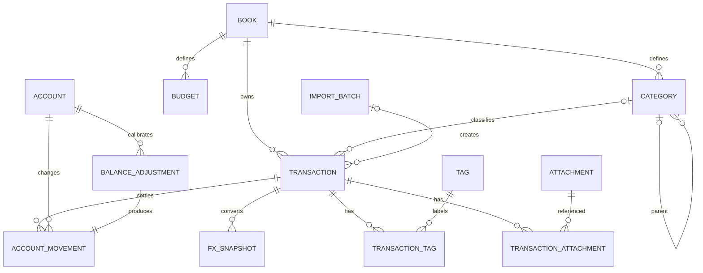

# 数据库逻辑模型 V1 · 评审草案

日期：2026-11-02。**业务规则已确认；配套SQL为待接入的评审草案，不是已运行的应用迁移。** 本稿建议使用ArkData关系型数据库，以SQLite兼容模型设计；运行时能力以项目SDK和真机验证为准。

## 1. 数据分层

主数据（账本、账户、分类、币种） → 用户账目 → 账户资金变动 → 统计与预算查询。

账目表达用户记录的事实；资金变动表达账户币种下的实际收付，两者分开。统计不能直接把账户资金变动相加当作支出；转账本金和余额校准也不进入普通收支。

上图采用用户已确认的方案：账户与余额全局共用，交易归属各自账本。账户表不包含book_id。

## 2. 身份、时间与通用字段

- 业务主键采用离线可生成的UUID文本，禁止将华为账号ID作为本地账目的主键或必填外键。
- 用户主数据/账目使用`id, created_at_ms, updated_at_ms, revision, deleted_at_ms`。revision用于本地乐观锁，不宣称可以解决未来多端冲突。
- 业务发生时间与创建时间分开：`occurred_at_ms`、`occurred_local_date`（YYYY-MM-DD）、`occurred_timezone`、`occurred_offset_minutes`。导入保存原始时间文本及解析规则；缺时区不默认伪装成UTC，需明确所用时区。
- 月度统计按保存的记账本地日期归组，避免用户旅行或切换系统时区后历史账目换月。改业务日期必须同时更新本地日期和瞬时时间表示。
- 首版以软删除支持撤销/追溯，归档与删除是不同状态。可恢复删除仍保留关系和图片；永久清理另设明确操作。
- 普通行级更新时间不意味着数据已经上传。手动备份阶段不建立自动同步队列、服务端用户表或冲突合并器。

## 3. 币种和金额

### 精度

金额用币种最小单位的**INTEGER**保存，不能用REAL。`28.00 CNY`保存为2800；币种精度不是固定两位。原币、优惠、结算和统计金额分别保留对应币种。

单个写入值建议限制在ArkTS number安全整数范围内，域层从字符串解析并验证范围，不经`parseFloat × 100`。超出安全范围的INTEGER读取使用字符串并按精确整数处理。本机SDK明确提示`getLong`的number安全范围及超范围使用`getString`；不可因为ValueType接受bigint，就假设其落库类型是可直接SUM的普通INTEGER。

SQL SUM仅对整数列使用；不得用TOTAL或转REAL绕过溢出。SQL 64位累计溢出时分批读取并在域层用精确整数求和，最终仍进行输出范围检查。汇率乘除使用精确十进制/有理数运算，不能先转浮点再四舍五入。具体ArkTS实现及依赖另行评审，本轮不安装库。

### 币种与汇率表

| 表 | 核心字段 | 约束/用途 |
| --- | --- | --- |
| currencies | id、code、numeric_code、name、symbol、minor_unit、valid_from/to、source_version、is_enabled | 币种定义有版本；被历史数据引用的精度不可原地更改。符号不是唯一标识；停用不删除历史定义。 |
| fx_quotes | id、from_currency_id、to_currency_id、rate_decimal、quoted_at_ms、provider、fetched_at_ms | 可维护的参考汇率历史；`1 from = rate to`按主单位定义。汇率为规范十进制TEXT，必须为正。缺价不能当1。 |
| fx_snapshots | id、transaction_id、account_movement_id（结算时关联具体资金腿）、role、from_currency_id、to_currency_id、from_minor、to_minor、rate_decimal、rate_source、rate_time_ms、rounding_mode、calculation_version | 本笔实际采用的换算结果与依据，role区分账本折算/账户结算；业务交易编辑才产生明确修订，更新参考价不回写旧账。 |

相同币种的单位换算无需重复存汇率。跨币实际扣款由用户或来源账单确认，优先保留实际金额；参考报价不能覆盖银行实际结算。本笔金额两端可得时，精确比值由两端金额和精度推导；展示汇率的小数位截断不能反过来重算实扣。

建议默认ROUND_HALF_UP，作为有版本的产品计算规则，并记录舍入结果；实际账单结算值优先。手续费独立为关联支出，不藏进汇率差。

币种代码、精度及历史状态需从ISO 4217维护机构的版本化资料维护；不把本稿示例当成完整币种种子表，不扩充到虚拟币或基金份额精度。

## 4. 主数据

| 表 | 核心字段 | 规则 |
| --- | --- | --- |
| books | id、name、base_currency_id、timezone、icon_key、sort_order、archived_at_ms | 一笔账目只归属一本账；有交易/预算后，基准币种不可静默更改，需另行设计明确重算流程。 |
| accounts | id、name、kind、currency_id、brand、icon_key、icon_variant、brand_color、include_in_net_assets、archived_at_ms、revision | 已确认全局账户。一个账户一种币种；多币银行卡先建不同币种子账户，不在一行余额内混币。账户有变动后不直接修改币种。 |
| categories | id、book_id、kind、parent_id、name、name_key、icon_key、sort_order、archived_at_ms | 支出/收入分类分开；支持多级且任意父节点可记账。父子同账本同类型，禁止循环。 |
| category_closure（视图） | ancestor_id、descendant_id、depth | 含自身depth=0，用于下级查询、分类统计；首版使用递归视图，parent_id是唯一存储来源，避免维护两套树。移动时校验无环及同账本同类型。 |
| tags | id、book_id、name、name_key、color_token、sort_order | 每个账本内名称去重；首版不引入多级标签。 |
| merchants | id、name、normalized_name、default_address、archived_at_ms | 建议全局商户供各账本复用；交易保存名称/地址快照。相同名称可能是不同门店，不只按名字强制合并。 |

账户`include_in_net_assets`是账户级展示规则，与单笔“计入资产”、导入余额策略分开。资产类账户以正余额为正资产；负债统一按对净资产的有符号贡献保存（欠款为负），显示“待还”时再转换展示，不把两套正负含义混存。

分类改名影响当前分类显示；原始导入分类文本独立保留。移动分类默认使用当前分类树统计，旧分类口径报告如有需求须另行定义，不宣称已有历史树版本。删除有关联分类必须明确重分类或归档；父分类不能静默级联删除全部账目。

## 5. 用户账目

### transactions

| 字段组 | 建议字段 |
| --- | --- |
| 身份与归属 | id、book_id、kind（expense/income/transfer）、group_id |
| 分类 | category_id；支出/收入要求有效分类，导入未分类须由用户明确选择系统未分类项；转账不使用收支分类 |
| 支出性质 | spending_nature_id；V3 新增的支出单值维度，收入/转账必须为空，历史账目允许为空 |
| 原币与优惠 | currency_id、gross_minor、discount_minor、paid_minor；非负整数，gross−discount=paid；收入/转账discount=0 |
| 统计快照 | book_currency_id、book_minor；收支按本笔折算快照固化；转账本金不参与收支累计，book_minor可空，不为无关统计强制补第三币种报价 |
| 规则 | include_in_budget、include_in_assets（是否影响账户余额）、balance_mode（apply/preserve） |
| 辅助信息 | reimbursement_status（none/pending）、merchant_id、merchant_name_snapshot、address_text、latitude_e6/longitude_e6、note |
| 导入来源 | import_batch_id、import_row_id（可空且非空时唯一）、source_provider、source_namespace、source_record_id（TEXT）、source_fingerprint、duplicate_override |
| 时间/审计 | 业务发生时间字段、created_at_ms、updated_at_ms、revision、deleted_at_ms |

支出、收入金额本身保存非负值，方向由kind决定；正常账目要求paid_minor>0，完全减免或原始金额为0的导入行先留待处理。资金变动表才保存正负delta。优惠在原币层减一次，实付字段来自文件时先确认语义，不再次减免。

一个group_id用于将转账本金与手续费支出关联。手续费仍是普通支出，按自己的预算规则处理；不能直接对不同币种转账两端做金额相等校验。转账两侧账户必须不同且完整。

待报销先做标记，不把勾选改成收入、不自动冲回支出。实际报销收款、部分报销、退款、分摊等尚未确认，不新增对应业务类型；导入这些来源状态先留待处理。

`balance_mode=preserve`按每笔记录固化，不能仅依赖以后可被清理的import_batch；默认历史导入采用preserve，后续普通编辑/删除不会突然生成余额变化。`include_in_assets`不作为preserve的替代字段。

### 关系表

- transaction_tags：主键(transaction_id, tag_id)，双方归属同一本账。标签可多选。
- transaction_attachments：主键(transaction_id, attachment_id)，含sort_order、caption；同一图片内容可被多个账目引用。

## 6. 资金变动与余额校准

| 表 | 核心字段 | 作用 |
| --- | --- | --- |
| account_movements | id、account_id、transaction_id或adjustment_id（二选一）、leg（expense/income/transfer_out/transfer_in/adjustment）、currency_id、delta_minor、occurred_at_ms | 保存账户币种下的实际金额；来源必须存在，币种必须等于账户币种；同一来源与leg唯一，防止重复生成。 |
| balance_adjustments | id、account_id、kind（opening/calibration）、before_minor、after_minor、delta_minor、reason、occurred_at_ms、created_at_ms、revision、posting_state、reversal_of_id | 初始余额与校准的独立事件；delta=after−before。不是收入或支出，不计预算。 |

已确认：当前账户余额=已发布初始/校准delta + 有效且允许改变余额的交易movement之和；交易是否影响余额同时检查`balance_mode`和`include_in_assets`。保留原始结算movement可支持详情展示，但preserve记录不能进入余额累计。

账户余额缓存不是第二套真相。首版先查变动明细；性能确有需要再增加可重建缓存，并与账目写入放在同一数据库事务内。

校准时读取当前余额和revision，计算差额并写调整与movement；并发保存须重读或乐观锁失败，不用过期余额算差额。before/after是操作时快照。建议调整落库后固定delta，后来编辑旧账仍会改变当前余额，不能偷偷重算校准差额抵消旧账变化；历史校准的修改/撤销用明确的反向调整处理。

每个账户的有效opening调整最多一条；校准目标等于当前余额时按无变动处理，不生成虚假收支。初始余额只创建一次；有数据后用户“改余额”生成calibration，不覆盖accounts中的一个裸balance字段。初始余额以前的历史余额未知时不展示为0。

**余额影响判定已确认**：只有账目已发布、未删除、导入批次（如有）已提交，且include_in_assets=1、balance_mode=apply时，交易资金变动才进入账户余额。预算独立按include_in_budget判断。不使用账户的收支允许没有movement；没有账户时不产生余额影响。

| include_in_assets | balance_mode | 影响账户余额 | 影响预算 |
| --- | --- | --- | --- |
| 1 | apply | 是 | 按独立预算标记与交易类型 |
| 0 | apply | 否 | 按独立预算标记与交易类型 |
| 1 | preserve | 否 | 按独立预算标记与交易类型 |
| 0 | preserve | 否 | 按独立预算标记与交易类型 |

账户级include_in_net_assets只控制净资产展示，不改变账户余额，也不替代单笔标记。净资产先按币种分组，跨币种估值另选明确报价时点，缺价时不能假装得到完整总资产。

## 7. 预算

- budgets：id、book_id、period_start_date、period_end_date_exclusive、currency_id、total_minor、revision、deleted_at_ms。首版支持已有月预算，区间避免月末时间边界。
- budget_lines：id、budget_id、category_id、amount_minor。分类与预算同账本；分类额度是否允许超总额需业务校验，不能默默重新分配。
- 使用额来自有效支出、业务日期落在区间且include_in_budget=1的book_minor；收入、转账本金、余额调整排除。
- 子分类消费可向祖先汇总，但同一笔支出在一个预算额度内只计一次。总预算不能通过“父预算已用+子预算已用”求和。
- 预算币种首版等于账本基准币种，直接使用历史book_minor；参考汇率更新不重算已发生预算。历史import preserve仍可按原日期和预算标记计入历史预算。

## 8. 图片与文件

attachments建议字段：id、content_sha256、relative_path、mime_type、byte_size、width、height、state（staged/ready/missing）、created_at_ms、deleted_at_ms。

图片原件放应用沙箱的受控文件目录，数据库只存相对路径和元信息；不把大图片塞入账目行，也不把临时图库URI当成持久文件。只允许生成的文件名，不接受导入值拼接任意路径。sha256用于校验/去重，不等于加密。

写入顺序：临时文件 → 校验并发布为不可变内容文件 → 事务写入ready附件和关联。失败可留下孤立文件供延迟清理，不能提交指向未准备文件的ready关联。垃圾清理须排除仍被账目、可恢复删除和正在备份引用的文件。

商户地址为每笔文本快照；坐标可选，首版不申请定位权限或默认上传。图片元数据的隐私处理属于后续附件实现，不能宣称已有去位置能力。

## 9. 导入、导出与去重

| 表 | 核心字段 | 规则 |
| --- | --- | --- |
| import_profiles | id、name、source_kind、profile_version、parse_options_json、column_mapping_json、value_mapping_json、updated_at_ms | 保存字段映射和解析规则。列用序号+表头标识，支持同名列；不保存隐含更新余额默认。 |
| import_batches | id、book_id、file_sha256、file_name、sheet_name、header_row、encoding、delimiter、profile_snapshot_json、balance_mode、status、total/selected/skipped_count、confirmed_at_ms、committed_at_ms、error_code | 每个新批次默认preserve。只有明确确认后才能提交。状态区分staged/validated/committing/committed/failed。 |
| import_rows | id、batch_id、sheet_name、row_number、raw_json、normalized_json、validation_status、issue_codes_json、duplicate_candidate_ids_json、selected；对应transaction_id通过transactions.import_row_id查询，不重复存两份映射 | staging不进入业务查询；batch+sheet+row唯一。原始内容有大小和保留期限制，不进日志、不执行其中公式。 |

列映射与账户/分类值匹配分开。创建新主数据必须显式确认；分类按完整路径匹配，来源交易编号作为文本保留前导零。多币种缺必要字段时留待处理，不编造0金额或历史汇率。

查重索引可按(provider, namespace, source_record_id)查询，但**不能设无条件唯一约束阻止用户明确保留重复**。相似日期/金额只能提示；选择保留须记duplicate_override。业务幂等用(import_batch_id, import_row_id)唯一来源关系，重试已提交批次返回原结果，不能重复插入。

确认后在单个数据库事务内写账目、资金变动、关系和批次提交标记；任一失败整体回退，不把分批进度当成已提交。大文件先分批staging，业务最终提交策略须经容量测试，不能悄悄改成部分成功。

导出是读取一致快照的任务，不复制成另一份业务账表。保留金额整数/精度/币种语义，CSV/Excel安全编码和公式处理由导出层负责。生成和系统保存状态分开。首版可用任务日志记录结果，尚无必要为每个导出页面状态建业务表。

## 10. 备份、恢复与未来同步

- db_meta保存dataset_id、schema_version、creation_time等；schema_migrations保存已完成版本与校验信息，后续迁移先备份再事务执行。
- WebDAV备份包由一致数据库快照、被快照引用的ready图片及manifest组成。manifest含格式版本、数据库schema版本、文件清单/大小/hash、dataset_id和生成时间；写在包外层，不把自身hash写回被校验数据库。
- 优先验证平台RdbStore.backup生成快照的适用性，不直接复制仍在写入的主.db文件。数据库快照不等于图片也已备好；快照窗口内暂停业务写入并固定附件引用，图片不可变，清理器在打包完成前不得删除被引用文件。
- 本地临时包完成并校验后再发布远端最终文件；上传成功不等于另一台设备自动合并。手动恢复按用户选择的完整备份恢复，不能按updated_at自动拼接两台数据库。
- 恢复先在独立暂存目录验证结构版本、外键、文件hash和资源限额；新版本不兼容则拒绝。停止写入、关闭连接、保留当前完整回退副本后才切换；事务/文件切换的崩溃恢复机制需专门实现与故障测试。
- WebDAV密码、令牌、华为登录凭据进入平台安全存储，不写普通业务表，也不随备份自动复制。设备级授权与本地偏好分开管理。
- 为未来同步保留稳定ID、revision和删除标记只是降低改造成本，不等同于已具备多端合并。个人云空间是否可用以及SDK接口另行核实。

## 11. 约束、索引和写入边界

DDL定稿时应落实：外键；金额INTEGER类型与范围；布尔0/1；币种引用；父子同账本同类型；分类无环；transaction与adjustment来源二选一；实际结算币种匹配；转账两侧完整；同来源leg唯一；同批次行幂等；同关系组合唯一。

不能只靠SQLite类型亲和性保证整数，金额需检查typeof为integer；浮点/小数文本不能悄悄写成REAL。跨行、跨表业务约束由事务服务和必要数据库约束共同保证，不宣称单个CHECK可以验证另一张表。

建议索引：账目(book_id, occurred_local_date, id)、分类(book_id, kind, parent_id, sort_order)、movement(account_id, occurred_at_ms, id)、外部来源(provider, namespace, source_record_id)、导入行(batch_id, validation_status, selected)、附件关联(transaction_id, sort_order)。索引与软删除查询条件在DDL阶段共同验证。

所有写入经同一事务入口：新增/编辑/删除账目时先核对revision，计算旧/新有效资金影响，再原子更新账目、movement、标签和附件关系。转账和关联手续费整组处理；不能先扣一侧账户再异步补另一侧。更换账本涉及分类、标签、预算币种及折算，不能只改book_id。

不设计完整复式会计总账、拆分分录、多人共享或投资持仓，这些没有得到需求确认。

## 12. 评审示例与下一步验证

1. 30.00−2.00=28.00 CNY，支出/预算按2800，账户实际扣款按结算movement。
2. 100 USD消费、实际扣719.80 CNY：原币10000 USD minor，结算71980 CNY minor；按本笔快照显示统计，不被下次报价更新覆盖。
3. 跨币转账与手续费：转出币、转入币各自精确，手续费单独作为支出；本金不能进收入或预算。
4. 当前余额10000.00，补录28.00支出且preserve：余额仍10000.00；改备注、改金额、删除都不能意外变余额。
5. apply支出28.00改为30.00：只追加对当前有效余额的净差−2.00；整组失败必须无一侧残留。
6. 校准12980.50，相对于当时13000.00生成−19.50调整；不生成消费，不计预算。
7. 三级分类父节点可记账；移动节点不成环；预算祖先汇总不重复计算。
8. 导入120条，选112、跳8；同一批次重试不能生成第二套账目。用户显式保留疑似重复时允许。
9. 图片发布失败、导入事务失败、备份缺图片、恢复中断、数据库版本过新分别有可验证的失败路径。

已产出 [SQL草案](schema-v1.sql)、[生成字段字典](schema-reference.md) 及 [纯内存验证](verify_schema.py)。当前57项测试通过。实际RDB、持久化迁移、故障恢复和备份联调尚未执行，不能将主机SQLite测试视为HarmonyOS运行验证。

## 参考依据

- [SQLite数值精度](https://www.sqlite.org/floatingpoint.html)：整数精确、浮点近似，金额设计不使用REAL。
- [SQLite聚合函数](https://www.sqlite.org/lang_aggfunc.html)：SUM整数累计与溢出，TOTAL返回浮点；不能用浮点回避精度问题。
- [SQLite外键](https://www.sqlite.org/foreignkeys.html)：外键启用和一致性检查需在实际连接验证。
- [SQLite备份](https://www.sqlite.org/backup.html)：一致快照与直接文件复制有不同约束；HarmonyOS实际使用平台接口验证。
- [SIX / ISO 4217](https://www.six-group.com/en/products-services/financial-information/market-reference-data/data-standards.html)：币种代码与minor unit维护依据。
- 本机SDK：`/Applications/DevEco-Studio.app/Contents/sdk/default/openharmony/ets/api/@ohos.data.relationalStore.d.ts`，核实ValueType、getLong/getString、事务与backup/restore声明；未视为设备测试。
- 需求依据：[导入导出规则](../design/import-export.md)、[辅助页面规则](../design/native-secondary-pages.md)。
